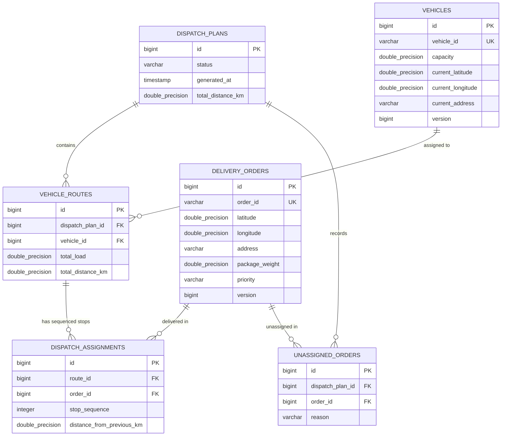
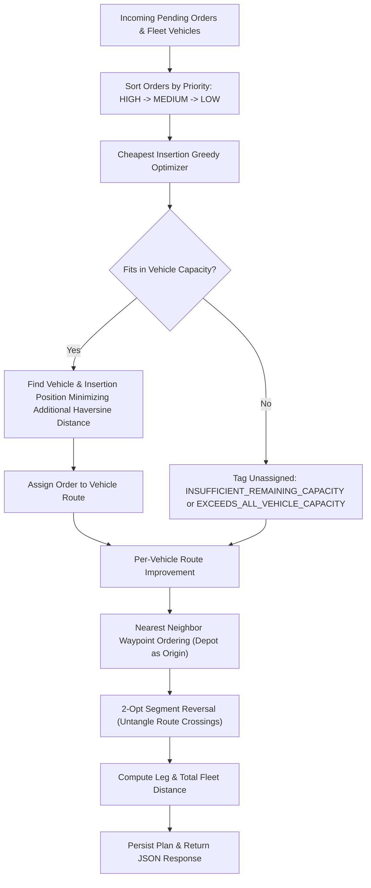

# Dispatch Load Balancer

A high-performance, production-grade Spring Boot service designed to solve the **Capacitated Vehicle Routing Problem (CVRP)** with strict **multi-tier priority scheduling**, **vehicle load capacity constraints**, and **Haversine great-circle distance minimization**.

## Live Demo & API Documentation

| Resource | Link |
|---|---|
| **Live Backend** | [Dispatch Load Balancer](https://dispatch-load-balancer-v15h.onrender.com/) |
| **Swagger UI** | [Explore API Documentation](https://dispatch-load-balancer-v15h.onrender.com/swagger-ui.html) |
| **OpenAPI Specification** | [View OpenAPI JSON](https://dispatch-load-balancer-v15h.onrender.com/api-docs) |
| **Postman Documentation** | [Explore Postman Collection](https://documenter.getpostman.com/view/39898850/2sBYHbsbjw) |

> **Note:** The application is hosted on Render's free tier. The service may take some time to respond after a period of inactivity.

---

## Table of Contents
1. [Key Features & Business Rules](#1-key-features--business-rules)
2. [Technology Stack](#2-technology-stack)
3. [System Architecture & Design Patterns](#3-system-architecture--design-patterns)
4. [Domain Model & Relational Schema](#4-domain-model--relational-schema)
5. [Optimization Algorithm Pipeline](#5-optimization-algorithm-pipeline)
6. [API Specifications & cURL Reference](#6-api-specifications--curl-reference)
7. [Sample Dataset & Empirical Results (30 Orders, 5 Vehicles)](#7-sample-dataset--empirical-results-30-orders-5-vehicles)
8. [Setup, Configuration & Execution](#8-setup-configuration--execution)
9. [Automated Test Suite (38 Tests)](#9-automated-test-suite-38-tests)
10. [Error Handling & HTTP Status Codes](#10-error-handling--http-status-codes)

---

## 1. Key Features & Business Rules

- **Multi-Tier Priority Scheduling**: Delivery orders are prioritized by urgency (`HIGH` > `MEDIUM` > `LOW`). When vehicle load capacity is tight, high-priority orders are strictly allocated before medium- or low-priority orders.
- **Hard Capacity Boundary Enforcement**: No fleet vehicle is ever loaded beyond its rated maximum weight capacity.
- **Accurate Haversine Distance Calculation**: Great-circle distances between geographic coordinates $(\text{latitude}, \text{longitude})$ are computed using a spherical Earth radius of $R = 6371.0088\text{ km}$, with floating-point clamping to safeguard against boundary rounding anomalies.
- **Three-Stage Route Optimization**:
  1. *Cheapest Insertion Greedy Allocation*: Assigns orders to the vehicle and route position that minimizes additional travel distance while respecting remaining capacity.
  2. *Nearest Neighbor Sequencing*: Reorders waypoints per vehicle starting from its base depot.
  3. *2-Opt Local Search Improvement*: Untangles crossing delivery legs to achieve minimal overall travel distance.
- **Intelligent Cache Invalidation**: Previously computed plans are automatically marked as `STALE` whenever new orders or vehicles are ingested, ensuring `GET /api/dispatch/plan` always returns an up-to-date schedule.
- **Detailed Unassigned Order Diagnostics**: Orders that cannot be scheduled due to fleet capacity limits are surfaced with explicit reason codes (`INSUFFICIENT_REMAINING_CAPACITY` or `EXCEEDS_ALL_VEHICLE_CAPACITY`).
- **Batch Upsert & Concurrency Protection**: High-throughput ingestion with $O(1)$ batch lookups (`findBy...In`), in-memory matching, and `@Version` optimistic locking.

---

## 2. Technology Stack

- **Language**: Java 21 (LTS)
- **Framework**: Spring Boot 4.x / 3.x (`spring-boot-starter-webmvc`, `spring-boot-starter-data-jpa`, `spring-boot-starter-validation`)
- **Database**: PostgreSQL 15+ (Production) / H2 In-Memory with PostgreSQL compatibility mode (Automated Testing)
- **Object-Relational Mapping**: Hibernate 6.x / Spring Data JPA
- **API Documentation**: Springdoc OpenAPI 3.0.2 / Swagger UI
- **Boilerplate Reduction**: Project Lombok
- **Testing**: JUnit 5, Mockito, Spring Boot MockMvc, AssertJ

---

## 3. System Architecture & Design Patterns

The service adheres to Clean Architecture and SOLID design principles with strict layer boundaries:

```text
com.dispatchloadbalancer
│
├── algorithm
│   ├── GreedyDispatchOptimizer.java         # Cheapest insertion allocation strategy
│   ├── HaversineCalculator.java             # Spherical great-circle distance calculator
│   ├── NearestNeighborRouteOptimizer.java   # Waypoint sequencing heuristic
│   └── TwoOptRouteOptimizer.java            # 2-opt pairwise segment reversal
│
├── config
│   └── OpenApiConfig.java                   # Swagger / OpenAPI 3 specification metadata
│
├── controller
│   ├── DispatchController.java              # Plan generation, retrieval & system reset
│   ├── OrderController.java                 # Delivery order ingestion & listing
│   └── VehicleController.java               # Fleet vehicle registration & listing
│
├── dto
│   ├── request
│   │   ├── OrderRequest.java                # Single order validation model
│   │   ├── OrdersRequest.java               # Batch order payload wrapper
│   │   ├── VehicleRequest.java              # Single vehicle validation model
│   │   └── VehiclesRequest.java             # Batch vehicle payload wrapper
│   │
│   └── response
│       ├── ApiResponse.java                 # Standard REST response envelope
│       ├── AssignedOrderResponse.java       # Sequenced drop point with leg distance
│       ├── DispatchPlanResponse.java        # Root dispatch plan output
│       ├── OrderResponse.java               # Stored order representation
│       ├── UnassignedOrderResponse.java     # Unschedulable order with reason code
│       ├── VehicleDispatchResponse.java     # Allocated vehicle route and load summary
│       └── VehicleResponse.java             # Stored vehicle representation
│
├── entity
│   ├── DeliveryOrder.java                   # Persistent delivery order entity
│   ├── DispatchAssignment.java              # Waypoint stop sequence on a route
│   ├── DispatchPlan.java                    # Root plan entity (status, total distance)
│   ├── UnassignedOrder.java                 # Audit record for unscheduled orders
│   ├── Vehicle.java                         # Persistent vehicle entity
│   └── VehicleRoute.java                    # Vehicle-to-plan association with load/distance
│
├── enums
│   ├── DispatchStatus.java                  # PLANNED, STALE, COMPLETED, FAILED
│   ├── Priority.java                        # HIGH (0), MEDIUM (1), LOW (2)
│   └── UnassignedReason.java                # INSUFFICIENT_REMAINING_CAPACITY, EXCEEDS_ALL_VEHICLE_CAPACITY
│
├── exception
│   ├── DuplicateResourceException.java      # 409 Conflict for duplicate business IDs
│   ├── GlobalExceptionHandler.java          # Centralized @RestControllerAdvice
│   ├── InvalidDispatchRequestException.java  # 400 Bad Request for empty state execution
│   ├── InvalidOrderException.java           # 400 Bad Request for invalid order fields
│   ├── InvalidVehicleException.java         # 400 Bad Request for invalid vehicle fields
│   └── ResourceNotFoundException.java       # 404 Not Found for missing entities
│
├── repository
│   ├── DeliveryOrderRepository.java         # Order batch queries & lookups
│   ├── DispatchPlanRepository.java          # Multi-query eager fetch & staleness updates
│   └── VehicleRepository.java               # Fleet vehicle batch queries & lookups
│
├── service
│   ├── DispatchService.java                 # Planning orchestration & reset contract
│   ├── OrderService.java                    # Order ingestion contract
│   ├── VehicleService.java                  # Fleet management contract
│   └── impl
│       ├── DispatchServiceImpl.java         # Multi-pass optimization pipeline
│       ├── OrderServiceImpl.java            # Upsert & plan invalidation logic
│       └── VehicleServiceImpl.java          # Upsert & plan invalidation logic
│
└── strategy
    └── DispatchOptimizationStrategy.java   # Strategy interface for allocation algorithms
```

### Key Design Patterns Applied
- **Strategy Pattern**: `DispatchOptimizationStrategy` isolates the assignment heuristic from `DispatchServiceImpl`, enabling drop-in substitution of optimization algorithms (e.g., Genetic Algorithms, Simulated Annealing) without changing business services.
- **Data Transfer Object (DTO) Pattern**: Decouples internal database entities from external API contracts, preventing over-exposure of internal schema or version fields.
- **Repository Pattern**: Encapsulates database queries using Spring Data JPA, providing batch fetching to eliminate N+1 query patterns.
- **Builder Pattern**: Applied across all DTOs and entities for immutable, fluent object creation.

---

## 4. Domain Model & Relational Schema



### Relational Schema Design Highlights
- **Eager-Loading Query Phasing**: In `DispatchPlanRepository`, routes, assignments, and unassigned orders are fetched via three consecutive join queries. This eliminates Hibernate's `MultipleBagFetchException` while preventing N+1 query overhead.
- **Concurrency Control**: `DeliveryOrder` and `Vehicle` entities include `@Version` fields for optimistic locking during concurrent batch upserts.
- **Database Constraints**: Foreign keys are reinforced with compound unique constraints (`[route_id, stop_sequence]` and `[dispatch_plan_id, order_id]`) to prevent duplicate assignments at the database level.

---

## 5. Optimization Algorithm Pipeline



1. **Cheapest Insertion ($O(N \cdot V \cdot K)$)**: Orders are evaluated in priority order (`HIGH` first). For each order, the algorithm checks each vehicle's remaining capacity. If feasible, it evaluates all possible insertion positions and selects the one that introduces the minimum additional travel distance:
   $$\Delta d = d(\text{prev}, \text{new}) + d(\text{new}, \text{next}) - d(\text{prev}, \text{next})$$
2. **Nearest Neighbor Sequencing ($O(K^2)$ per vehicle)**: Re-sequences the assigned stops starting from the vehicle's depot, selecting the closest unvisited stop iteratively.
3. **2-Opt Local Search ($O(K^2)$ per iteration)**: Evaluates non-adjacent edge pairs $(i, i+1)$ and $(j, j+1)$ and reverses the sub-route between $i$ and $j$ whenever:
   $$d(i, j) + d(i+1, j+1) < d(i, i+1) + d(j, j+1)$$
   The search terminates once no further distance reduction is possible.

---

## 6. API Specifications & cURL Reference

### 6.1. Ingest Delivery Orders
- **Endpoint**: `POST /api/dispatch/orders`
- **Headers**: `Content-Type: application/json`
- **cURL**:
  ```bash
  curl -X POST http://localhost:8080/api/dispatch/orders \
    -H "Content-Type: application/json" \
    -d '{
      "orders": [
        {
          "orderId": "ORD001",
          "latitude": 12.9716,
          "longitude": 77.5946,
          "address": "MG Road, Bangalore, Karnataka, India",
          "packageWeight": 10.0,
          "priority": "HIGH"
        },
        {
          "orderId": "ORD002",
          "latitude": 13.0827,
          "longitude": 80.2707,
          "address": "Anna Salai, Chennai, Tamil Nadu, India",
          "packageWeight": 20.0,
          "priority": "MEDIUM"
        }
      ]
    }'
  ```
- **Response** (`201 Created`):
  ```json
  {
    "status": "success",
    "message": "Delivery orders accepted."
  }
  ```

---

### 6.2. Ingest Fleet Vehicles
- **Endpoint**: `POST /api/dispatch/vehicles`
- **Headers**: `Content-Type: application/json`
- **cURL**:
  ```bash
  curl -X POST http://localhost:8080/api/dispatch/vehicles \
    -H "Content-Type: application/json" \
    -d '{
      "vehicles": [
        {
          "vehicleId": "VEH001",
          "capacity": 100.0,
          "currentLatitude": 12.9716,
          "currentLongitude": 77.6413,
          "currentAddress": "Indiranagar, Bangalore, Karnataka, India"
        },
        {
          "vehicleId": "VEH002",
          "capacity": 150.0,
          "currentLatitude": 13.0674,
          "currentLongitude": 80.2376,
          "currentAddress": "T Nagar, Chennai, Tamil Nadu, India"
        }
      ]
    }'
  ```
- **Response** (`201 Created`):
  ```json
  {
    "status": "success",
    "message": "Vehicle details accepted."
  }
  ```

---

### 6.3. Retrieve Optimized Dispatch Plan
- **Endpoint**: `GET /api/dispatch/plan`
- **Description**: Returns the active dispatch plan. If existing cached plans are stale or missing, a fresh plan is computed and persisted automatically.
- **cURL**:
  ```bash
  curl -X GET http://localhost:8080/api/dispatch/plan
  ```
- **Response** (`200 OK`):
  ```json
  {
    "planId": 1,
    "status": "PLANNED",
    "generatedAt": "2026-11-18T23:25:00",
    "totalDistance": "11.07 km",
    "dispatchPlan": [
      {
        "vehicleId": "VEH001",
        "currentAddress": "Indiranagar, Bangalore, Karnataka, India",
        "totalLoad": 10.0,
        "capacity": 100.0,
        "totalDistance": "5.07 km",
        "assignedOrders": [
          {
            "orderId": "ORD001",
            "latitude": 12.9716,
            "longitude": 77.5946,
            "address": "MG Road, Bangalore, Karnataka, India",
            "packageWeight": 10.0,
            "priority": "HIGH",
            "stopSequence": 1,
            "distanceFromPrevious": "5.07 km"
          }
        ]
      },
      {
        "vehicleId": "VEH002",
        "currentAddress": "T Nagar, Chennai, Tamil Nadu, India",
        "totalLoad": 20.0,
        "capacity": 150.0,
        "totalDistance": "6.00 km",
        "assignedOrders": [
          {
            "orderId": "ORD002",
            "latitude": 13.0827,
            "longitude": 80.2707,
            "address": "Anna Salai, Chennai, Tamil Nadu, India",
            "packageWeight": 20.0,
            "priority": "MEDIUM",
            "stopSequence": 1,
            "distanceFromPrevious": "6.00 km"
          }
        ]
      }
    ],
    "unassignedOrders": []
  }
  ```

---

### 6.4. Retrieve Stored Orders & Vehicles
- **List All Orders**: `GET /api/dispatch/orders`
- **List All Vehicles**: `GET /api/dispatch/vehicles`

---

### 6.5. Reset Dispatch System State
- **Endpoint**: `DELETE /api/dispatch/reset`
- **Description**: Deletes all delivery orders, fleet vehicles, routes, assignments, and generated dispatch plans.
- **cURL**:
  ```bash
  curl -X DELETE http://localhost:8080/api/dispatch/reset
  ```
- **Response** (`200 OK`):
  ```json
  {
    "status": "success",
    "message": "Dispatch data reset successfully"
  }
  ```

---

## 7. Sample Dataset & Empirical Results (30 Orders, 5 Vehicles)

The application was empirically evaluated using the benchmark dataset provided in the assignment:
- **Total Delivery Orders**: 30 orders, cumulative weight $= 645.0\text{ kg}$
  - `HIGH` Priority: 12 orders ($275.0\text{ kg}$)
  - `MEDIUM` Priority: 8 orders ($145.0\text{ kg}$)
  - `LOW` Priority: 10 orders ($225.0\text{ kg}$)
- **Total Fleet Capacity**: 5 vehicles, cumulative capacity $= 500.0\text{ kg}$
  - `VEH001` (Karol Bagh): $100\text{ kg}$
  - `VEH002` (Noida Sector 18): $80\text{ kg}$
  - `VEH003` (Gurgaon Cyber Hub): $120\text{ kg}$
  - `VEH004` (Connaught Place): $90\text{ kg}$
  - `VEH005` (Karol Bagh): $110\text{ kg}$

### Execution & Constraint Verification
Because total demand ($645\text{ kg}$) exceeds fleet capacity ($500\text{ kg}$), the system enforces constraint-driven prioritization:

| Vehicle ID | Starting Depot | Capacity | Assigned Load | Utilization | Stop Count |
| :--- | :--- | :---: | :---: | :---: | :---: |
| `VEH001` | Karol Bagh, Delhi | $100\text{ kg}$ | $95.0\text{ kg}$ | 95.0% | 5 stops |
| `VEH002` | Sector 18, Noida | $80\text{ kg}$ | $80.0\text{ kg}$ | 100.0% | 3 stops |
| `VEH003` | Cyber Hub, Gurgaon | $120\text{ kg}$ | $115.0\text{ kg}$ | 95.8% | 5 stops |
| `VEH004` | Connaught Place, Delhi | $90\text{ kg}$ | $85.0\text{ kg}$ | 94.4% | 4 stops |
| `VEH005` | Karol Bagh, Delhi | $110\text{ kg}$ | $110.0\text{ kg}$ | 100.0% | 6 stops |
| **Fleet Totals** | | **$500.0\text{ kg}$** | **$485.0\text{ kg}$** | **97.0%** | **23 stops** |

- **Orders Assigned**: 23 out of 30 orders.
- **Priority Precedence Satisfaction**: 100% of `HIGH` orders (12/12) and 100% of `MEDIUM` orders (8/8) were successfully assigned.
- **Unassigned Orders**: Exactly 7 orders, **all of which are strictly `LOW` priority** (`ORD006`, `ORD016`, `ORD019`, `ORD022`, `ORD024`, `ORD028`, `ORD030`).
- **Capacity Integrity**: No vehicle exceeded its rated capacity ($0$ capacity violations).
- **Duplicate Prevention**: Every order was scheduled at most once.

---

## 8. Setup, Configuration & Execution

### Prerequisites
- **JDK**: Java 21 LTS installed and set in `JAVA_HOME`.
- **Build Tool**: Apache Maven 3.8+ (or system `mvn`).
- **Database**: PostgreSQL 15+ (for production mode; test suite runs hermetically on embedded H2).

### Database Configuration (`application.properties`)
Configure PostgreSQL credentials using standard environment variables or direct properties:
```properties
# Database connection
spring.datasource.url=${DB_URL:jdbc:postgresql://${DB_HOST:localhost}:${DB_PORT:5432}/${DB_NAME:dispatch_load_balancer}}
spring.datasource.username=${DB_USERNAME:postgres}
spring.datasource.password=${DB_PASSWORD:postgres}
spring.datasource.driver-class-name=org.postgresql.Driver

# Hibernate DDL and SQL logging
spring.jpa.hibernate.ddl-auto=update
spring.jpa.show-sql=false
spring.jpa.properties.hibernate.format_sql=true

# Logging levels
logging.level.root=INFO
logging.level.com.dispatchloadbalancer=INFO
logging.level.com.dispatchloadbalancer.algorithm=DEBUG
logging.level.org.hibernate.SQL=DEBUG
logging.level.org.hibernate.orm.jdbc.bind=WARN
```

### Build & Run
```bash
# 1. Compile the project
mvn clean compile

# 2. Run all 38 automated tests
mvn test

# 3. Start the Spring Boot application
mvn spring-boot:run
```

Once started, the application listens on port `8080`.
The interactive Swagger / OpenAPI UI is accessible at:
```text
http://localhost:8080/swagger-ui.html
```

---

## 9. Automated Test Suite (38 Tests)

The test suite provides comprehensive test coverage across algorithms, services, and HTTP controllers.

```bash
mvn test
```

### Test Suite Structure

| Test Class | Focus Area | Tests | Status |
| :--- | :--- | :---: | :---: |
| [HaversineCalculatorTest](file:///home/hemant/Desktop/Frightfox/Dispatch-Load-Balancer/src/test/java/com/dispatchloadbalancer/algorithm/HaversineCalculatorTest.java) | Great-circle distance accuracy, boundary coordinate validation | 5 | Passed |
| [GreedyDispatchOptimizerTest](file:///home/hemant/Desktop/Frightfox/Dispatch-Load-Balancer/src/test/java/com/dispatchloadbalancer/algorithm/GreedyDispatchOptimizerTest.java) | Priority precedence, capacity constraints, unassigned reason codes | 4 | Passed |
| [NearestNeighborRouteOptimizerTest](file:///home/hemant/Desktop/Frightfox/Dispatch-Load-Balancer/src/test/java/com/dispatchloadbalancer/algorithm/NearestNeighborRouteOptimizerTest.java) | Depot origin ordering, waypoint sequencing, small routes | 4 | Passed |
| [TwoOptRouteOptimizerTest](file:///home/hemant/Desktop/Frightfox/Dispatch-Load-Balancer/src/test/java/com/dispatchloadbalancer/algorithm/TwoOptRouteOptimizerTest.java) | Crossing route untangling, distance reduction, segment reversals | 3 | Passed |
| [OrderServiceTest](file:///home/hemant/Desktop/Frightfox/Dispatch-Load-Balancer/src/test/java/com/dispatchloadbalancer/service/OrderServiceTest.java) | Batch order upsert, duplicate rejection, plan invalidation | 3 | Passed |
| [VehicleServiceTest](file:///home/hemant/Desktop/Frightfox/Dispatch-Load-Balancer/src/test/java/com/dispatchloadbalancer/service/VehicleServiceTest.java) | Batch vehicle upsert, duplicate rejection, plan invalidation | 3 | Passed |
| [OrderControllerTest](file:///home/hemant/Desktop/Frightfox/Dispatch-Load-Balancer/src/test/java/com/dispatchloadbalancer/controller/OrderControllerTest.java) | MockMvc POST/GET orders, validation errors (400), duplicates (409) | 5 | Passed |
| [VehicleControllerTest](file:///home/hemant/Desktop/Frightfox/Dispatch-Load-Balancer/src/test/java/com/dispatchloadbalancer/controller/VehicleControllerTest.java) | MockMvc POST/GET vehicles, contract validation, duplicates (409) | 5 | Passed |
| [DispatchControllerTest](file:///home/hemant/Desktop/Frightfox/Dispatch-Load-Balancer/src/test/java/com/dispatchloadbalancer/controller/DispatchControllerTest.java) | MockMvc GET plan, root `dispatchPlan` array, DELETE reset | 3 | Passed |
| [DispatchPlanIntegrationTest](file:///home/hemant/Desktop/Frightfox/Dispatch-Load-Balancer/src/test/java/com/dispatchloadbalancer/DispatchPlanIntegrationTest.java) | Full E2E with 30 orders & 5 vehicles, capacity, priority, cache | 2 | Passed |
| [DispatchLoadBalancerApplicationTests](file:///home/hemant/Desktop/Frightfox/Dispatch-Load-Balancer/src/test/java/com/dispatchloadbalancer/DispatchLoadBalancerApplicationTests.java) | Spring context initialization | 1 | Passed |
| **Total** | | **38** | **All Passed** |

---

## 10. Error Handling & HTTP Status Codes

The application uses a centralized `@RestControllerAdvice` in [GlobalExceptionHandler.java](file:///home/hemant/Desktop/Frightfox/Dispatch-Load-Balancer/src/main/java/com/dispatchloadbalancer/exception/GlobalExceptionHandler.java):

| HTTP Status | Exception / Scenario | Response Payload |
| :--- | :--- | :--- |
| `200 OK` | Successful retrieval (`GET`) or reset (`DELETE`) | Standard payload or `ApiResponse.success(...)` |
| `201 Created` | Successful order or vehicle ingestion (`POST`) | `{"status": "success", "message": "..."}` |
| `400 Bad Request` | Bean validation failure (`@DecimalMin`, `@NotBlank`, etc.) | `{"status": "error", "message": "Validation failed", "data": {...}}` |
| `400 Bad Request` | Missing input data when generating plan | `{"status": "error", "message": "No delivery orders found. ..."}` |
| `400 Bad Request` | Malformed JSON or invalid priority enum string | `{"status": "error", "message": "Malformed JSON or invalid value ..."}` |
| `404 Not Found` | Requested endpoint or resource does not exist | `{"status": "error", "message": "Endpoint not found"}` |
| `409 Conflict` | Duplicate `orderId` or `vehicleId` in request batch | `{"status": "error", "message": "Duplicate orderId in request: ..."}` |
| `500 Internal Server Error` | Unexpected system exception | `{"status": "error", "message": "An unexpected error occurred"}` |
